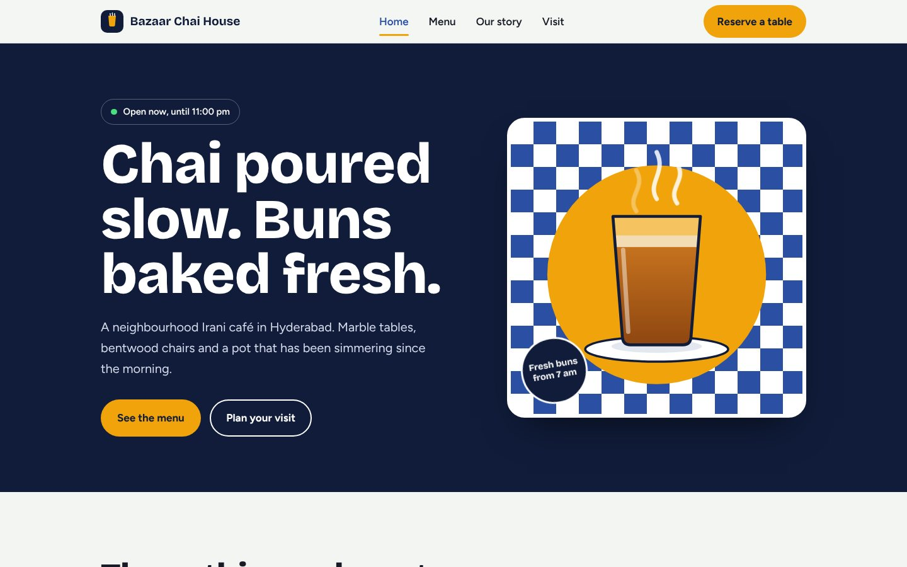
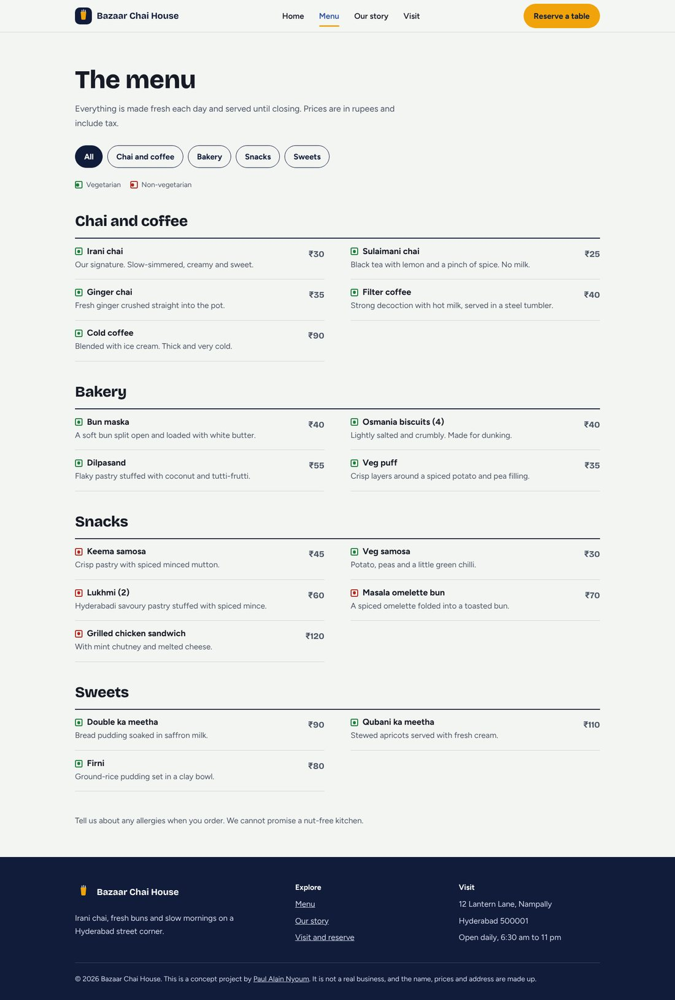
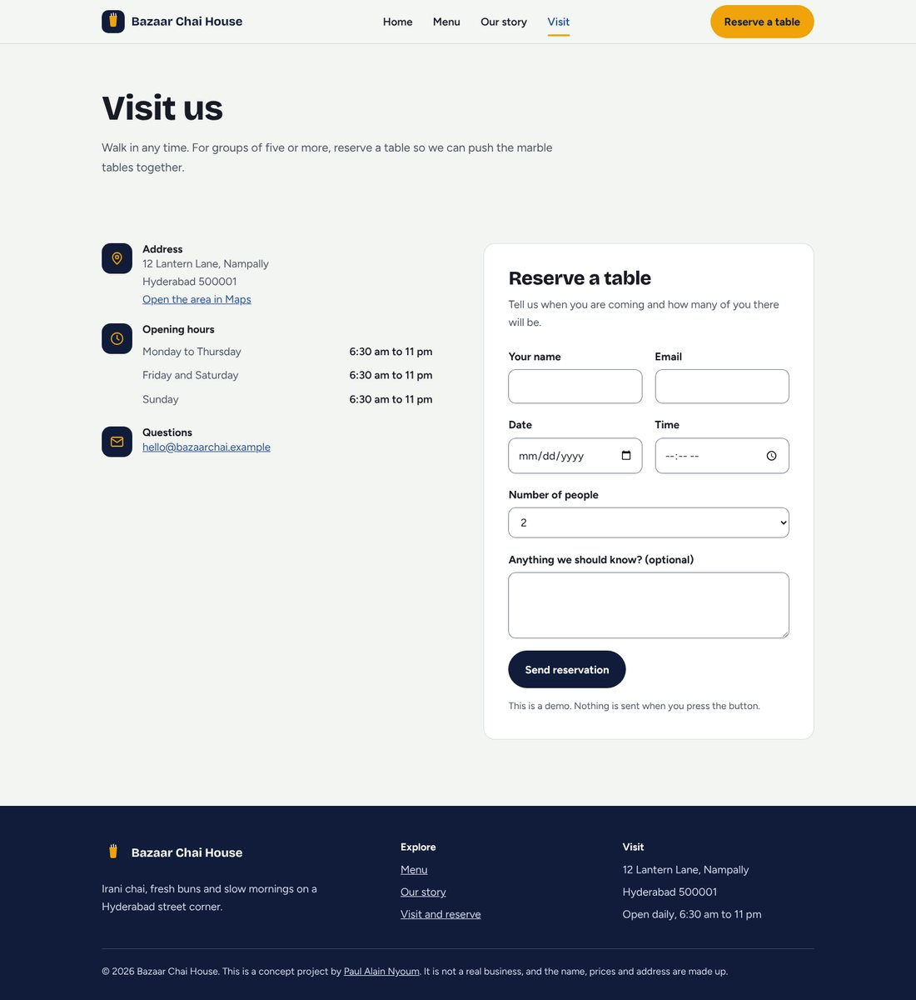
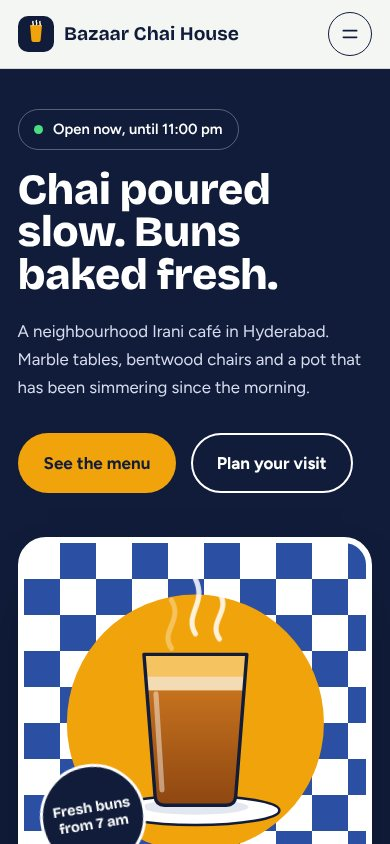

# Bazaar Chai House

A concept website for an Irani café in Hyderabad. Four pages built with plain HTML, CSS and JavaScript, with no frameworks and no build step.

> This is a practice project. Bazaar Chai House is not a real business, and the name, address, prices and email are made up.



| Menu | Visit and reserve | Home on a phone |
|---|---|---|
|  |  |  |

**Live demo:** add your GitHub Pages link here once it is published.

## What it shows

- A small business site that is easy to read, fast and mobile-first
- A visual identity built for the subject: blue and white Irani-café checks, saffron and navy, and an illustration drawn in SVG
- Content that helps the visitor: a menu with vegetarian marks, opening hours and a table reservation form

## Features

- **Four pages:** Home, Menu, Our story, Visit and reserve
- **"Open now" badge** that follows the café's own time zone (India), whatever time zone the visitor is in
- **Menu filter** by section, with a live count of the items shown
- **Reservation form** with clear error messages, a date that cannot be in the past and a time inside opening hours (demo only: nothing is sent)
- **Mobile menu** that closes with Escape, on a link click, on an outside click and when the screen widens
- **Accessible by design:** skip link, visible focus rings, labelled form fields, vegetarian marks that do not rely on colour alone, and reduced-motion support
- **No external requests:** the two fonts are included in `assets/fonts`

## Project structure

```
index.html  menu.html  story.html  visit.html
css/style.css        all styles, with colours and sizes set once in :root
js/main.js           menu, open-now badge, filter and form checks
assets/fonts/        Bricolage Grotesque and Figtree (SIL Open Font License)
docs/                screenshots used in this README
```

## Run it

Open `index.html` in a browser. Or start a small local server:

```
python3 -m http.server 8000
```

then visit http://localhost:8000.

## Publish on GitHub Pages

1. Create a new public repository, for example `chai-house`.
2. Upload everything in this folder, with `index.html` at the top level.
3. In **Settings → Pages**, choose the main branch and the root folder.
4. After a minute or two the site is live at `https://YOUR-USERNAME.github.io/chai-house/`.

## Change the details

- Opening hours: the top of `js/main.js` (and the text in the HTML pages)
- Colours: the `:root` block at the top of `css/style.css`
- Menu items: `menu.html`

## Testing

Checked in Chromium at 360, 390, 768, 1024 and 1440 px wide: no sideways scrolling on any page, the keyboard can reach every control, text contrast meets WCAG AA, and animation stops when the visitor prefers reduced motion.

## Credits

- Fonts: Bricolage Grotesque and Figtree, SIL Open Font License 1.1, from Fontsource
- Illustrations and icons: drawn for this project as inline SVG
- Built by [Paul Alain Nyoum](https://github.com/Paulalan2509)
